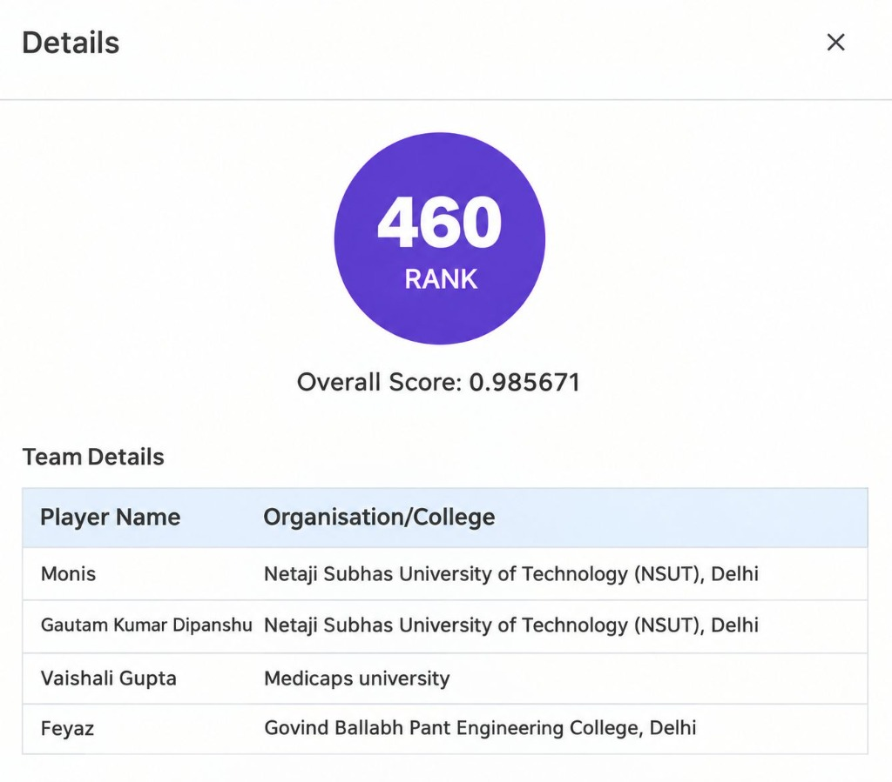
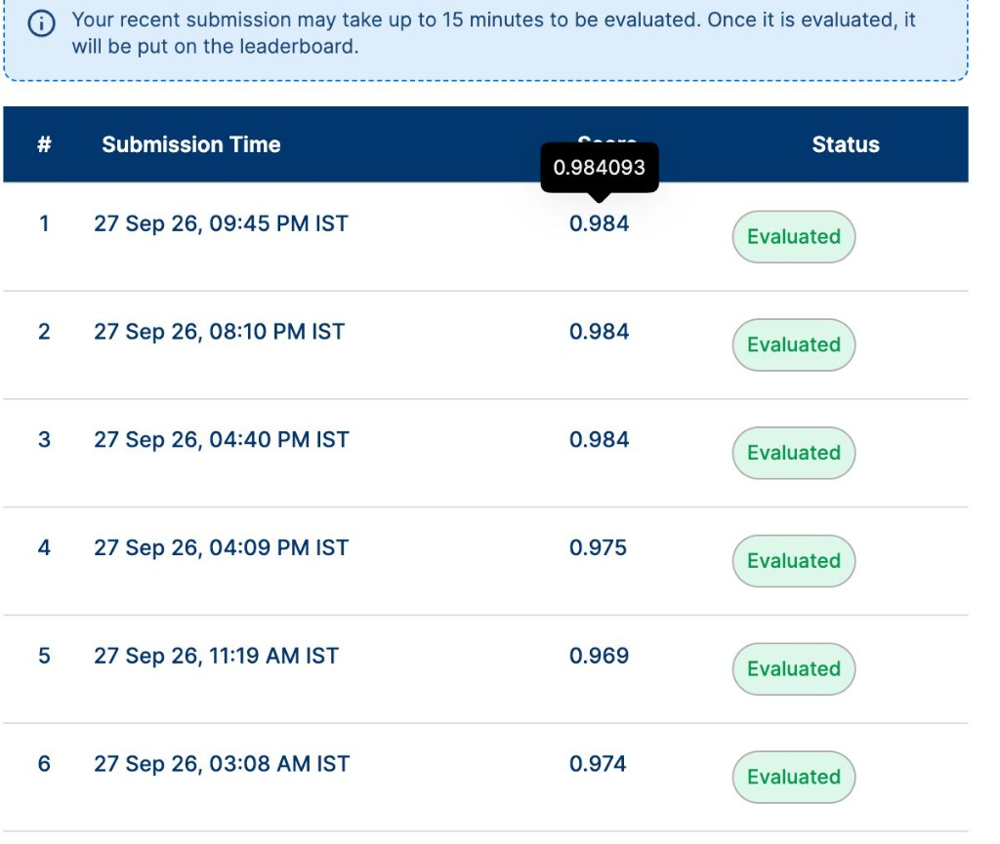

# Amazon ML Challenge 2026: Business Entity Resolution

[](#leaderboard--results)
[](#leaderboard--results)
[](#evaluation-metric)
[](https://opensource.org/licenses/MIT)

An end-to-end, high-performance machine learning pipeline developed for the **Amazon ML Challenge 2026: Business Entity Resolution Challenge**. 

The task requires resolving and linking business records across three noisy, heterogeneous data sources ($S_1$, $S_2$, $S_3$) without shared foreign keys. Our solution combines component-based multilingual normalization, multi-view sparse TF-IDF blocking, two-stage LightGBM classification (pairwise + context/graph competition modeling), and an expected-$F_{0.5}$ decision engine.

---

## Leaderboard & Results

- **Official Rank:** 460
- **Final Overall Score:** **0.985671** ($Macro\ F_{0.5}$)
- **Top Portal Submission:** **0.984093**
- **Out-of-Fold Validation Score:** **0.98654** (evaluated on 1.77M held-out $S_1$ entities with 20% orphan simulation)

<p align="center">
  
  
</p>

### Team Details

| Member | Institution |
| :--- | :--- |
| **Monis** | Netaji Subhas University of Technology (NSUT), Delhi |
| **Gautam Kumar Dipanshu** | Netaji Subhas University of Technology (NSUT), Delhi |
| **Vaishali Gupta** | Medi-Caps University |
| **Feyaz** | Govind Ballabh Pant Engineering College, Delhi |

---

## Challenge Summary

### Problem Formulation
Given three independent data sources:
- **Source 1 ($S_1$):** Deduplicated reference entity set.
- **Source 2 ($S_2$) & Source 3 ($S_3$):** Noisy record pools containing partial, misspelled, or reformatted entity fragments.

The goal is to map every $S_1$ entity to zero, one, or multiple corresponding records in $S_2$ and $S_3$. Key challenge characteristics:
1. **One-to-One Match Invariant:** A pool record in $S_2$ or $S_3$ corresponds to at most one $S_1$ business entity.
2. **High Name Collision & Adversarial Twins:** ~51% of $S_1$ entities share normalized name keys across different locations. Distractors often share the identical trade name and differ only in street or house number.
3. **Multilingual & Transliteration Noise:** Addresses and names contain English and Indic-script renderings (e.g., Devanagari), varying legal suffixes (`Pvt Ltd`, `LLC`, `Corp`), and unstandardized abbreviations.
4. **Unseen Country in Test:** While training covers the US and India, the test set introduces France (15% of test records) with zero ground-truth labels.

### Evaluation Metric
Submissions are evaluated on **Macro-averaged $F_{0.5}$ score** across all $S_1$ entities:

$$F_{0.5} = \frac{1.25 \times \text{Precision} \times \text{Recall}}{0.25 \times \text{Precision} + \text{Recall}}$$

$F_{0.5}$ weights precision twice as heavily as recall to penalize false mergers. Correctly predicting empty match sets for singletons receives an $F_{0.5}$ score of 1.0, while any false match on a singleton reduces its score to 0.0.

---

## Pipeline Architecture

The system operates as a five-stage sequential pipeline:

```
Raw TSV Data (S1, S2, S3)
   │
   ▼
[1] Multilingual Normalization & Address Decomposition
   │  ├── Train-pair learned Indic-to-Latin transliteration dictionary
   │  └── Component address parser (state, locality, postcode, house number, unit, street)
   ▼
[2] Multi-View Sparse Blocking & Streaming Pruner
   │  ├── Sparse TF-IDF (char 3-grams name, name+address, word-level address tokens)
   │  ├── Exact keys: (locality, street), (state, name_key), reverse pass
   │  └── Streaming LightGBM Pruner: 220M+ pairs → top ≤20 per S1 (98.64% recall)
   ▼
[3] Feature Engineering (~120 features)
   │  ├── Pairwise: RapidFuzz ratios, Jaro-Winkler, Numba token set overlaps, house-number delta
   │  └── Context: S1 competition margin, S2↔S3 mutual agreement, adversarial twin detector
   ▼
[4] Two-Stage GBDT Matching Model
   │  ├── Stage 1: Pairwise candidate scoring (LightGBM 5-fold GroupKFold by S1)
   │  └── Stage 2: Graph-level context model + Isotonic probability calibration
   ▼
[5] Structured Decision Engine
   │  ├── 1-to-1 global assignment constraint (bipartite matching with margin δ)
   │  └── Per-S1 expected-F0.5 maximization via Monte Carlo subset selection
   ▼
Final Outputs: matching_results.tsv & candidate_pairs.tsv
```

### 1. Preprocessing & Normalization
- **Indic Transliteration:** Ground-truth training pairs showed 100% token count alignment between Indic script names and English reference names. A 1.35K token translation table learned directly from training covers ~96% of test Indic tokens, with an algorithmic ITRANS fallback.
- **Component Address Parser:** Isolates state/province, locality, postal code, house numbers, sub-unit designations, and expanded road tokens without dictionary collisions (e.g., distinguishing state `CT` vs street suffix `ct`).

### 2. Multi-View Sparse Blocking
- Partitions candidates by `(country, state)` using `sparse_dot_topn` with char 3-grams and address word tokens, dropping high-frequency n-grams (>2% frequency) for a 20× speedup.
- Augments candidate pools with exact blocks on `(locality, street)` and `(locality, house_number, street_tok1)`.
- A streaming LightGBM prune model (25 lightweight features) reduces raw candidate pairs from ~220M to **7.8 pairs/entity (train)** and **8.9 pairs/entity (test)**, exporting the final candidate pool as `candidate_pairs.tsv`.

### 3. Feature Engineering
- **String Similarities:** Character and token-based metrics (Levenshtein, Jaro-Winkler, token set/sort ratio, consonant skeletons, rarest unmatched token IDF).
- **Address & Ambiguity Signals:** Exact house number matching, zero-stripped numeric deltas, address collision frequency, and postal code distance.
- **Context & Relational Features:** Captures intra-cluster dynamics:
  - *Competition:* Score margin to the second-best $S_1$ entity competing for the same candidate.
  - *Agreement:* Cross-source consistency between $S_2$ and $S_3$ candidates for the same $S_1$.
  - *Twin Detection:* Flags candidate pairs sharing a business name but possessing differing house numbers.

### 4. Classification & Calibration
- Two-stage LightGBM architecture trained under 5-fold GroupKFold grouped by $S_1$ entity ID.
- Out-of-fold predictions from Stage 2 are calibrated using isotonic regression to output accurate posterior probabilities $P(\text{match})$.

### 5. Optimal Decision Engine
Instead of applying a naive global threshold, our decision module:
1. Enforces the one-to-one constraint: assigns each $S_2/S_3$ record to at most one $S_1$ with margin $\delta = 0.1$.
2. Optimizes the exact $F_{0.5}$ metric per $S_1$ by selecting the candidate subset $K \subseteq \text{Cand}(S_1)$ that maximizes $\mathbb{E}[F_{0.5}(K)]$ using calibrated probabilities, naturally solving singleton identification ($K = \emptyset$).

---

## Validation & Ablation Study

Evaluated on 1.77M held-out $S_1$ training records with a 20% hidden orphan protocol:

| Pipeline Stage | Macro $F_{0.5}$ | Precision | Recall |
| :--- | :---: | :---: | :---: |
| Stage-1 Pairwise Baseline ($t = 0.5$) | 0.98187 | 0.9912 | 0.9458 |
| + One-to-One Assignment & Per-$S_1$ Expected $F_{0.5}$ | 0.98437 | 0.9951 | 0.9520 |
| Stage-2 Context Model ($t = 0.5$) | 0.98542 | 0.9960 | 0.9567 |
| Stage-2 + Global Tuned Threshold ($t = 0.7$) | 0.98635 | 0.9972 | 0.9612 |
| **Stage-2 + One-to-One ($\delta = 0.1$) + Expected $F_{0.5}$ (Final)** | **0.98654** | **0.9977** | **0.9645** |

### Per-Country & Subgroup Breakdown (Out-of-Fold)
- **United States:** $0.98731$
- **India:** $0.98537$
- **Singletons (No Match):** $0.98733$
- **Matched Entities:** $0.98649$

---

## Repository Structure

```
.
├── assets/
│   ├── leaderboard_rank.jpg           # Final rank & team details screenshot
│   └── submission_history.jpg         # Portal evaluated submission history
├── code/
│   └── business_entity_resolution/
│       ├── requirements.txt           # Pinned pipeline dependencies
│       ├── gpu_steps.sh               # Cross-encoder GPU training/inference script
│       ├── tests/
│       │   └── test_normalize.py      # Unit tests for text & address normalization
│       └── src/
│           ├── config.py              # Global paths, thresholds, and hyperparameters
│           ├── io_utils.py            # TSV/Parquet ingestion and ID mapping
│           ├── splits.py              # Hidden orphan split and 5-fold GroupKFold setup
│           ├── translit.py            # Indic-to-Latin transliteration engine
│           ├── normalize.py           # Name canonicalization & address component parser
│           ├── blocking.py            # Multi-view sparse TF-IDF & exact key blocking
│           ├── prune.py               # Streaming LightGBM candidate pruner
│           ├── features.py            # Pairwise string, address, and ambiguity features
│           ├── stage1.py              # Stage 1 pairwise LightGBM trainer & predictor
│           ├── context.py             # Stage 2 context/graph features & calibration
│           ├── crossencoder.py        # Optional multilingual cross-encoder integration
│           ├── decide.py              # One-to-one assignment & expected-F0.5 optimizer
│           ├── evaluate.py            # Macro F0.5 evaluation suite
│           ├── write_output.py        # Submission TSV generator
│           └── run_pipeline.py        # End-to-end master orchestrator
├── dataset/                           # Dataset directory (train & test TSVs)
├── utils/
│   └── validate_submission.py         # Official competition submission validator
├── Documentation_template.md          # Technical documentation write-up
├── make_submission_zip.sh             # Submission archive packager
├── requirements.txt                   # Root dependency specification
├── setup_env.sh                       # Environment bootstrapping script
├── run_gpu.sh                         # GPU execution script
└── README.md
```

---

## Setup & Reproduction

### 1. Prerequisites
- Python 3.10 or 3.11
- OpenMP (required for LightGBM on macOS):
  ```bash
  brew install libomp
  ```
- Recommended RAM: $\ge 32\text{ GB}$ (tested on Apple Silicon and Linux x86_64)

### 2. Environment Setup
```bash
# Create virtual environment
python3 -m venv .venv
source .venv/bin/activate

# Install dependencies
pip install --upgrade pip
pip install -r requirements.txt
pip install -r code/business_entity_resolution/requirements.txt
```

### 3. Data Placement
Place competition files under `dataset/`:
```
dataset/
├── train/
│   ├── train_source1.tsv
│   ├── train_source2.tsv
│   ├── train_source3.tsv
│   └── train_ground_truth.tsv
└── test/
    ├── test_source1.tsv
    ├── test_source2.tsv
    └── test_source3.tsv
```

### 4. Running the End-to-End Pipeline
Run the full CPU/GPU pipeline to generate both submission files:
```bash
cd code/business_entity_resolution/src
python3 run_pipeline.py
```

The pipeline outputs:
- `output/matching_results.tsv` — Final predicted matches for test $S_1$ entities.
- `output/candidate_pairs.tsv` — Pruned candidate pairs fed into the matching classifier.

### 5. Validate Output Format
Verify integrity against all competition constraints:
```bash
python3 utils/validate_submission.py \
    --matching output/matching_results.tsv \
    --candidate output/candidate_pairs.tsv \
    --test-dir dataset/test
```
